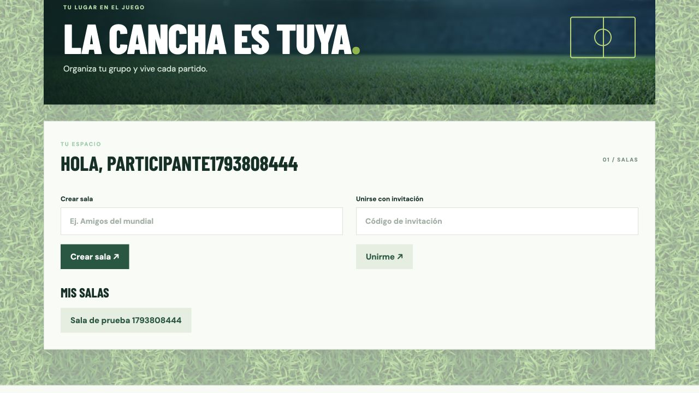
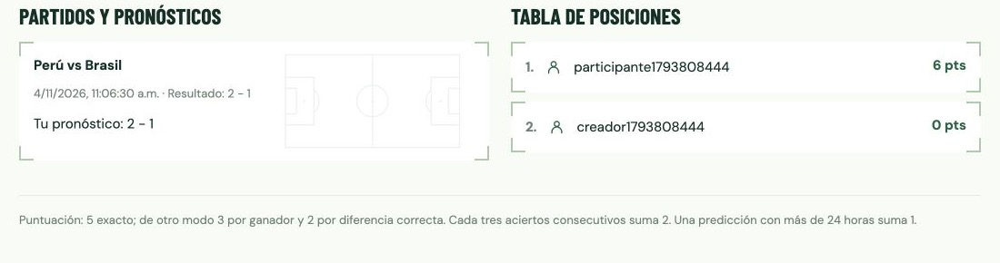

# Mi Mundial — laboratorio 12

Aplicación educativa de pronósticos sin dinero real. Permite registrar usuarios, crear salas, compartir códigos de invitación, registrar partidos y pronósticos, ingresar resultados y consultar el ranking por sala. El creador de la sala administra sus partidos y resultados.

## Capturas de la aplicación

### Ingreso


### Registro


### Salas



### Pronósticos y posiciones



El resultado y los puntos corresponden a datos de prueba. La fecha de ese partido se ajustó para probar el cálculo sin esperar al inicio.

## Arquitectura

```text
Navegador → Nginx :8080 → aplicación Node.js (2 réplicas) → PostgreSQL
                                                          ↳ volumen persistente
```

Nginx distribuye solicitudes entre dos réplicas. Los datos y las sesiones se guardan en PostgreSQL para que ambas instancias compartan el estado. Solo Nginx se publica en localhost; la aplicación y la base están en la red interna de Compose. Es una demostración local, no una configuración de producción: no incluye TLS, protección frente a ataques ni alta disponibilidad de la base de datos.

## Inicio

Requisitos: Docker Desktop y Docker Compose. En esta carpeta se generó un archivo local `.env` con una contraseña aleatoria. Para una copia nueva, crear `.env` con `DB_PASSWORD=` seguido de una contraseña alfanumérica aleatoria. No compartir ni subir este archivo.

```sh
docker compose up -d --build
```

Abrir http://localhost:8080. Registrar una cuenta e ingresar. Crear una sala y compartir su código con otro usuario; el creador agrega partidos futuros. Cada participante guarda su marcador antes del inicio. Los pronósticos se cierran al comenzar. El creador puede registrar o corregir el resultado a partir de dos horas después del inicio. La tabla se recalcula con cada consulta. Para detener sin borrar los datos: `docker compose down`. Para reiniciar: `docker compose up -d`. El volumen conserva los datos; `docker compose down -v` los borra permanentemente.

## Reglas e interpretación

- Marcador exacto: 5 puntos base, sin sumar ganador ni diferencia por separado.
- En otro caso: 3 por ganador o empate correcto, más 2 por diferencia firmada correcta. Por ejemplo, 3–1 y 2–0 suman 5; dos empates distintos también comparten diferencia cero. Esta interpretación resuelve la superposición de reglas de la guía.
- Por cada tres partidos consecutivos finalizados con ganador o empate acertado se suman 2 puntos. Un fallo o un partido finalizado sin predicción rompe la racha; se ordena por fecha de inicio e identificador.
- Una predicción registrada estrictamente más de 24 horas antes suma 1 punto, incluso si no acierta el resultado. Modificarla actualiza su fecha. A las 24 horas exactas o menos no obtiene ese punto.

## Verificación

Ejecutar `node --test test.js` para comprobar puntuación y rachas. El endpoint `GET /api/health` muestra la identidad de la réplica y comprueba la conexión a la base. La prueba de carga se ejecuta desde el mismo equipo contra ese endpoint; mide la ruta de salud, no representa el rendimiento de las operaciones de escritura ni de un entorno de producción.

### Resultados observados el 4 de noviembre de 2026

- Pruebas unitarias: 2 pruebas aprobadas, incluyendo marcador exacto, ganador, diferencia, anticipo y rachas.
- Flujo HTTP: dos registros e inicios de sesión; creación de sala, unión con código, creación de partido y registro de predicción satisfactorios.
- Persistencia: después de reiniciar las dos réplicas y PostgreSQL, la predicción seguía almacenada. Para poder probar el resultado sin esperar dos días se adelantó la fecha del partido de prueba mediante SQL; luego se registró el resultado por la API y el participante obtuvo 6 puntos (5 exactos y 1 de anticipo).
- Carga local: 1.000 peticiones a `/api/health`, 40 trabajadores concurrentes, 0,21 segundos en total (aprox. 4.813 solicitudes por segundo), sin errores observados. Ambas réplicas atendieron 500 solicitudes. La medición es puntual y depende del equipo y del estado del sistema.

Los datos de prueba permanecen en el volumen local. Los resultados no sustituyen una prueba de carga sostenida de toda la aplicación.
